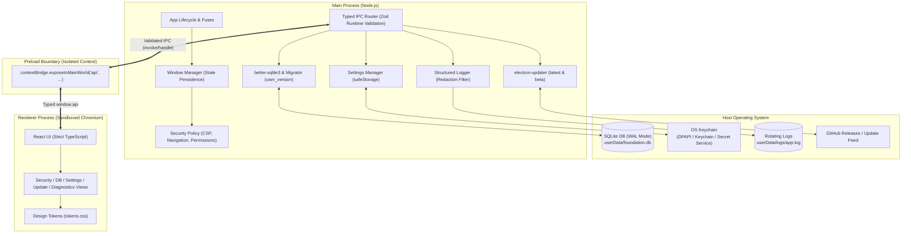

# electron-foundation

> Security-first Electron + TypeScript desktop foundation with typed IPC, local SQLite storage, auto-update from GitHub Releases and a signed Windows/macOS release pipeline.

[](https://github.com/thesanketkale/electron-foundation/actions/workflows/ci.yml)
[](https://github.com/thesanketkale/electron-foundation/releases)
[](LICENSE)

---

## 1. Why It Exists

Most Electron starters optimize for quick prototyping at the expense of security, shipping with default permissions, unrestricted IPC, unsafe `file://` protocols, and no clear path to signing or auto-updating. Hardening an Electron application for production usually requires days of research across Electron security checklists, native packaging quirks, OS-level code-signing requirements, and database migrations.

### How It Compares to Alternatives

- **versus `electron-react-boilerplate`**: That boilerplate relies on Webpack, lacks out-of-the-box runtime IPC schema validation, exposes broader IPC channels, and doesn't flip Electron Fuses or support Azure Trusted Signing. `electron-foundation` uses `electron-vite` with strict Zod contracts, custom `app://` protocol loading, and flipped security fuses.
- **versus Electron Forge templates**: Forge provides minimal scaffolding without built-in local-first SQLite persistence, rotating redacted logs, or a preconfigured multi-OS signed release pipeline.
- **versus Tauri**: While Tauri offers a lightweight Rust backend, many teams have deep TypeScript expertise, require full Chromium rendering fidelity, or rely on Node.js native ecosystem modules like `better-sqlite3`. `electron-foundation` brings Tauri-grade least-privilege security discipline to the Electron ecosystem.

---

## 2. Features

- **Hardened Security Model**: Context isolation, sandboxing, and Node integration disabled by default. Served from a custom privileged `app://` protocol with strict Content-Security-Policy headers and disabled webviews.
- **Electron Security Fuses**: RunAsNode, NODE_OPTIONS, and Inspect CLI arguments permanently disabled; ASAR integrity validation enforced and verified via automated test scripts.
- **Zero-Trust Typed IPC**: End-to-end type safety and runtime payload validation powered by Zod schemas in `src/shared/ipc.ts`, with sender frame origin verification on every invocation.
- **Local-First SQLite Storage**: Embedded `better-sqlite3` in WAL mode with sequential migrations tracked via `PRAGMA user_version` and one-click database snapshot backups.
- **Schema-Validated Settings & Secrets**: Preferences stored in validated JSON; sensitive API keys encrypted using Electron's `safeStorage` (Windows DPAPI, macOS Keychain, Linux Secret Service).
- **Structured Redacted Logging**: Rotating log files with automated pattern masking for Bearer tokens, API keys, and passwords, plus one-click diagnostic bundle export.
- **Pluggable Code Signing**: Unsigned builds succeed in CI by default. Pluggable production signing for Windows (Azure Trusted Signing or PFX Authenticode) and macOS (Developer ID + `notarytool`).
- **Auto-Update Pipeline**: Built-in `electron-updater` supporting both `latest` (stable) and `beta` (pre-release) channels with a local mock server for offline testing.

---

## 3. Quickstart

Get a working application running from a clean machine in five commands:

```bash
# 1. Clone repository
git clone https://github.com/thesanketkale/electron-foundation.git
cd electron-foundation

# 2. Install dependencies
npm install

# 3. Verify toolchain and security checks
./scripts/verify.ps1 full # (Unix: bash scripts/verify.sh full)

# 4. Start local development with Hot Module Replacement
npm run dev

# 5. Build and package unpacked release executable
npm run package
```

---

## 4. Architecture Overview

`electron-foundation` strictly separates privileges between the Node.js Main process, the Preload bridge, and the sandboxed Chromium Renderer:



Detailed architectural specifications and process flows are documented in [docs/architecture.md](docs/architecture.md).

---

## 5. Configuration Reference

| Environment Variable / Option | Default      | Purpose                                                                |
| ----------------------------- | ------------ | ---------------------------------------------------------------------- |
| `NODE_ENV`                    | `production` | Switches between local Vite dev server and packaged `app://` protocol. |
| `FOUNDATION_UPDATE_URL`       | _(none)_     | Override feed URL for testing auto-updater against local mock server.  |
| `AZURE_KEY_VAULT_URI`         | _(none)_     | Azure Trusted Signing endpoint URI.                                    |
| `AZURE_CERT_PROFILE_NAME`     | _(none)_     | Certificate profile name in Azure Trusted Signing account.             |
| `AZURE_CLIENT_ID`             | _(none)_     | Azure App Registration Client ID for signing authentication.           |
| `AZURE_CLIENT_SECRET`         | _(none)_     | Azure App Registration Client Secret for signing authentication.       |
| `CSC_LINK`                    | _(none)_     | Base64-encoded `.pfx` or `.p12` code-signing certificate.              |
| `CSC_KEY_PASSWORD`            | _(none)_     | Password unlocking the certificate specified in `CSC_LINK`.            |
| `APPLE_API_KEY`               | _(none)_     | Path or content of App Store Connect `.p8` API key for notarization.   |
| `APPLE_API_KEY_ID`            | _(none)_     | App Store Connect 10-character API Key ID.                             |
| `APPLE_API_ISSUER`            | _(none)_     | App Store Connect Issuer ID UUID.                                      |
| `APPLE_TEAM_ID`               | _(none)_     | Apple Developer Team ID for notarization.                              |

---

## 6. Usage Examples

### Executing a Safe IPC Call from React

```tsx
import { useEffect, useState } from 'react'
import type { NoteRecord } from '@shared/types'

export function NotesList(): React.JSX.Element {
  const [notes, setNotes] = useState<NoteRecord[]>([])

  useEffect(() => {
    // Calls typed method exposed via preload contextBridge
    window.api.db
      .getNotes()
      .then(setNotes)
      .catch((err) => console.error('Failed to load notes:', err))
  }, [])

  return (
    <ul>
      {notes.map((note) => (
        <li key={note.id}>{note.title}</li>
      ))}
    </ul>
  )
}
```

### Storing an Encrypted API Secret

```tsx
async function saveApiKey(key: string, secret: string) {
  // Encrypted via Windows DPAPI, macOS Keychain, or Linux Secret Service
  const result = await window.api.settings.setSecret(key, secret)
  console.info(`Stored via: ${result.encryptionMethod}`)
}
```

---

## 7. Troubleshooting & FAQ

### Q: Why does Windows SmartScreen warn when running the built executable?

**A**: Unsigned builds or binaries signed with newly issued certificates lack Microsoft Defender SmartScreen reputation. Click **More info -> Run anyway**. To eliminate this in production, configure Azure Trusted Signing or sign with an EV Authenticode certificate as described in [docs/release-and-signing.md](docs/release-and-signing.md).

### Q: Why does macOS Gatekeeper block the application?

**A**: macOS requires Developer ID code signing and notarization via Apple's notary service. For local testing of unsigned builds, right-click the `.app` bundle, select **Open**, and confirm.

### Q: How do I add a new SQLite table or alter existing schema?

**A**: Add an ordered `.sql` migration file in `src/main/db/migrations/` (e.g., `003_add_tags.sql`). The migrator tracks schema versions via `PRAGMA user_version` and executes migrations transactionally on application launch.

---

## 8. Security Notes & Known Limitations

- **Headless Linux Environments**: On headless Linux servers or CI containers lacking D-Bus and `libsecret`, Electron `safeStorage` is unavailable. The settings store automatically falls back to machine-salted AES-256-GCM encryption with an explicit warning.
- **Webviews**: `<webview>` tags are strictly disabled. If your application requires rendering third-party web content, use an isolated `WebContentsView` with strict navigation filters.
- **No Remote JavaScript**: The CSP forbids dynamic string evaluation (`eval`, `new Function`) and external scripts. All code must be bundled at build time.

See [docs/security.md](docs/security.md) for the complete Electron security audit.

---

## 9. Verification Status

| Feature / Acceptance Criteria         | Status             | Verification Mechanism                                                              |
| ------------------------------------- | ------------------ | ----------------------------------------------------------------------------------- |
| Strict TypeScript Compilation & Build | **CI-Proven**      | Verified via `tsc --noEmit` and `electron-vite build` across Linux, Windows, macOS. |
| Context Isolation & Chromium Sandbox  | **CI-Proven**      | Verified via Playwright E2E test launching Electron.                                |
| Strict Content-Security-Policy        | **CI-Proven**      | Verified via Playwright E2E asserting CSP headers and `eval()` rejection.           |
| Electron Fuses Enforcement            | **CI-Proven**      | Verified via `scripts/verify-fuses.mjs` asserting all 5 binary fuse bytes.          |
| Typed IPC & Zod Schema Validation     | **CI-Proven**      | Verified via Vitest unit tests and Playwright E2E invalid payload rejection.        |
| SQLite WAL & Sequential Migrations    | **CI-Proven**      | Verified via Vitest database unit tests and live CRUD persistence.                  |
| Auto-Update Local Flow                | **CI-Proven**      | Verified against local mock update server (`scripts/mock-update-server.mjs`).       |
| Unsigned Cross-Platform Packaging     | **CI-Proven**      | Verified via `electron-builder` producing NSIS, DMG, and AppImage artifacts.        |
| Windows Authenticode / Azure Signing  | **Owner-Verified** | Requires active Azure Trusted Signing profile or EV PFX certificate.                |
| macOS Developer ID & Notarization     | **Owner-Verified** | Requires paid Apple Developer subscription and App Store Connect API keys.          |
| Live GitHub Releases Updates          | **Owner-Verified** | Requires public release tag publish and live update feed download.                  |

Step-by-step verification commands for owner-verified criteria are provided in [docs/verification-log.md](docs/verification-log.md).

---

## 10. Roadmap, Contributing & License

- [x] Initial release with hardened security model, typed IPC, and SQLite migrations (`v0.1.0`).
- [ ] Multi-window state management and tabbed navigation.
- [ ] Web Worker offloading for CPU-intensive background tasks.
- [ ] Native notifications and system tray minimization.

Contributions are welcome! Please read [CONTRIBUTING.md](CONTRIBUTING.md) and [CODE_OF_CONDUCT.md](CODE_OF_CONDUCT.md).

This project is licensed under the [MIT License](LICENSE) &copy; 2026 Sanket Kale.

---

## 11. Related Projects

- **[job-desk](https://github.com/thesanketkale/job-desk)**: Local-first desktop job search and application assistant built on top of this foundation.
