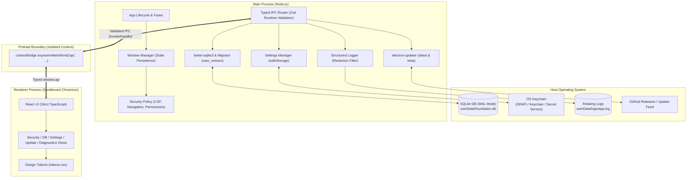

# Architecture Overview

`electron-foundation` is structured around strict separation of privileges, isolation of untrusted rendering, and deterministic, local-first data storage.

## Process Architecture

Electron executes in multiple processes. The Chromium multi-process model isolates the web renderer from the operating system, while Node.js primitives run exclusively in the Main process.

## Security Boundaries

### 1. The Renderer Process

- Operates under strict Chromium OS-level sandboxing (`sandbox: true`).
- Has **zero Node.js integration** (`nodeIntegration: false`). Direct access to `require()`, `process`, or native bindings is impossible.
- Context isolation (`contextIsolation: true`) ensures the DOM and preload JavaScript contexts cannot leak prototypes.
- Loaded through the custom privileged `app://` protocol instead of `file://`, providing a clean web origin without unrestricted local file system access.

### 2. The Preload Script

- Acts as a unidirectional gateway.
- Exposes only a strictly typed, immutable `window.api` object to the renderer.
- Raw `ipcRenderer.send` or `ipcRenderer.invoke` are never exposed.

### 3. The Main Process

- All inbound IPC invocations verify the sender frame origin (`isValidSenderFrame`).
- Payloads are validated against Zod schemas before being dispatched to domain services.
- Database access, file I/O, secret encryption, and external network communication happen exclusively here.

## Data Persistence & Schema Evolution

Local persistence is powered by embedded `better-sqlite3` located in `app.getPath('userData')`:

1. **Write-Ahead Logging (WAL)**: Enabled via `PRAGMA journal_mode = WAL`, allowing concurrent readers and writers without lock contention.
2. **Schema Migrations**: Numbered migration scripts (`001_initial.sql`, `002_add_indexes.sql`) execute sequentially inside an explicit database transaction. Version tracking is maintained in `PRAGMA user_version`.
3. **Backup Engine**: Live database snapshots are generated on demand via SQLite's online backup API without locking active queries.

## Secret Management

Secrets (API tokens, sensitive identifiers) are managed by `SettingsManager`:

- On Windows: Encrypted using the Data Protection API (DPAPI).
- On macOS: Encrypted using Apple Keychain.
- On Linux: Encrypted using Linux Secret Service (libsecret).
- Headless Linux Fallback: If no desktop secret service is available, credentials fall back to machine-local AES-256-GCM encryption with explicit warnings logged and displayed in the UI.
