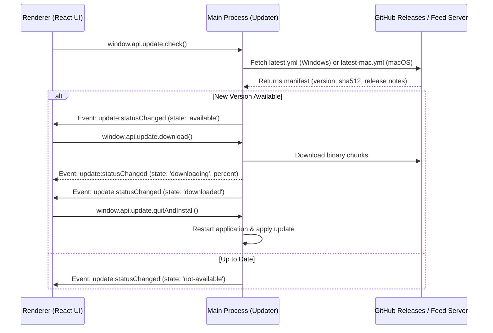

# Auto-Update Architecture & Configuration

`electron-foundation` integrates **`electron-updater`** for zero-friction background updates directly from GitHub Releases or custom feed providers.

## Architecture



## Release Channels

Users can switch between two release channels in Settings:

1. **Stable (`latest`)**: Pulls general production releases. Ignores pre-releases.
2. **Beta (`beta`)**: Allows pre-releases (tags containing `-beta`, e.g., `v0.2.0-beta.1`).

Configured in `src/main/updater/index.ts`:

```typescript
export function setUpdateChannel(channel: 'latest' | 'beta'): void {
  autoUpdater.channel = channel
  autoUpdater.allowPrerelease = channel === 'beta'
}
```

## Public GitHub Releases Provider

Because this is a public repository, `electron-updater` downloads update metadata and assets directly from GitHub without needing personal access tokens (PAT) or embedded credentials:

```yaml
# electron-builder.yml
publish:
  provider: github
  owner: thesanketkale
  repo: electron-foundation
  releaseType: release
```

## Offline & Local Testing with Mock Update Server

To verify update logic without deploying to GitHub, `scripts/mock-update-server.mjs` provides a local HTTP update server:

```bash
# 1. Start the mock update server in one terminal
npm run mock-updater

# 2. In another terminal, start the app with custom update feed URL
FOUNDATION_UPDATE_URL="http://127.0.0.1:8089" npm run dev
```

The mock update server serves:

- `http://127.0.0.1:8089/latest.yml`
- `http://127.0.0.1:8089/latest-mac.yml`
- Binary mock packages (`.exe`, `.zip`)
